# 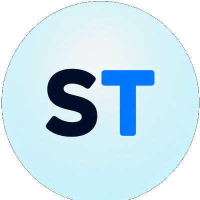 Simple Taskbar

  
  

Simple Taskbar gives GNOME a familiar taskbar, an optional Dock and a Start Menu.
Pin your favourite apps, preview open windows and choose a layout that suits you,
while keeping GNOME's clock, calendar, Quick Settings and extension icons.
Bring your desktop to life with macOS-style icon magnification and the Magic
Lamp animation when minimising and restoring windows.

**Supports GNOME Shell 48, 49, 50 and 51.**

## See it in action

  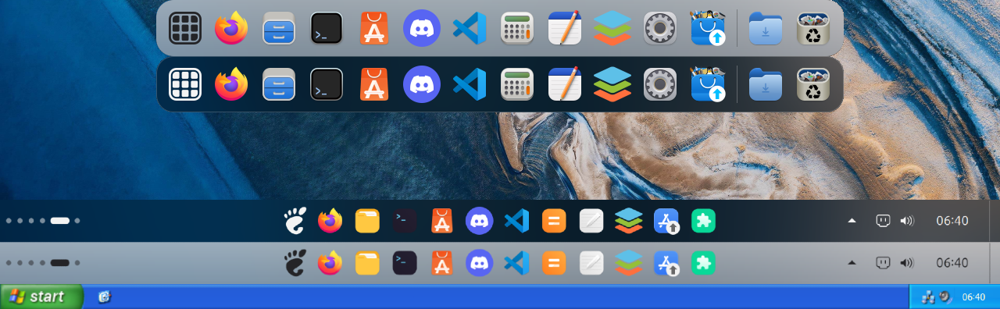
  
Taskbar, Windows XP Theme and Dock modes.

<table>
  <tr>
    <td align="center" width="50%">
      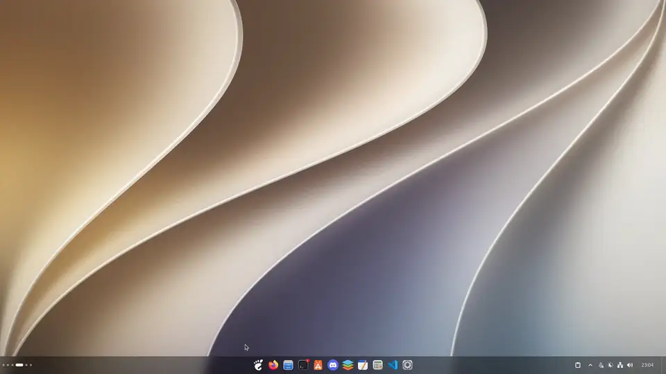
        <b>Taskbar Mode</b>
    </td>
    <td align="center" width="50%">
      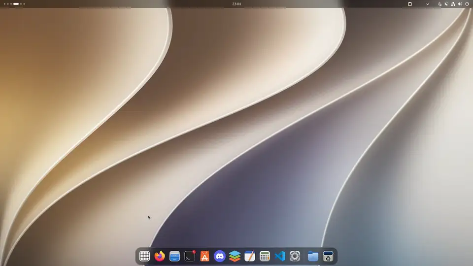
        <b>Dock with Icon Magnification</b>
    </td>
  </tr>
  <tr>
    <td align="center" width="50%">
      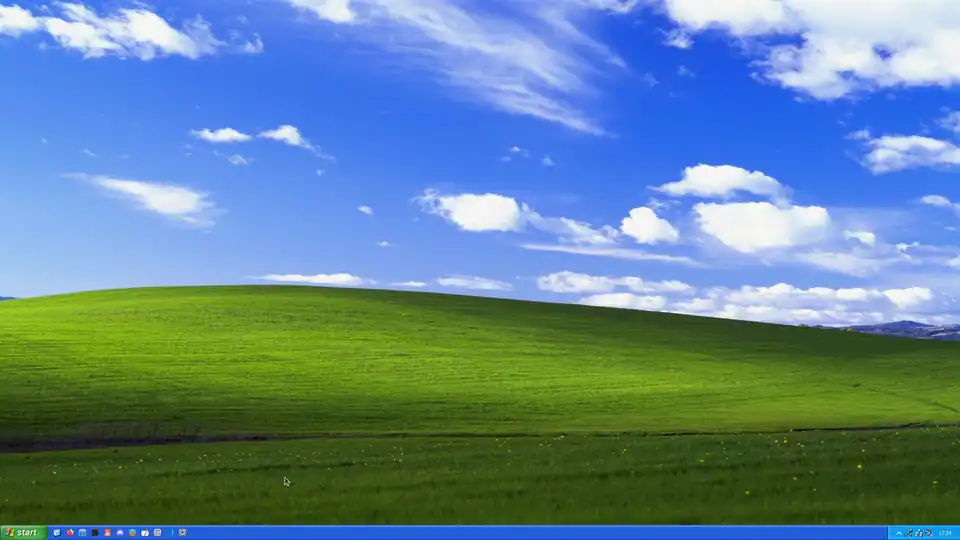
        <b>Windows XP Theme</b>
    </td>
    <td align="center" width="50%">
      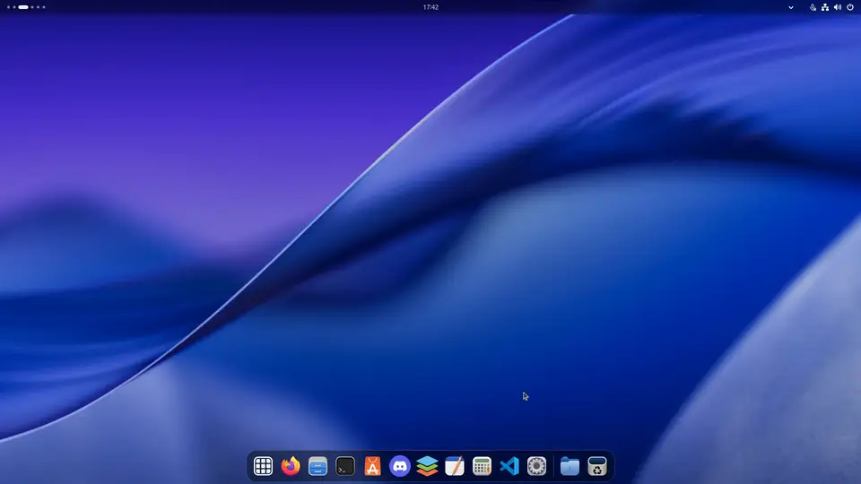
        <b>Hover Animations and Settings</b>
    </td>
  </tr>
  <tr>
    <td align="center" width="50%">
      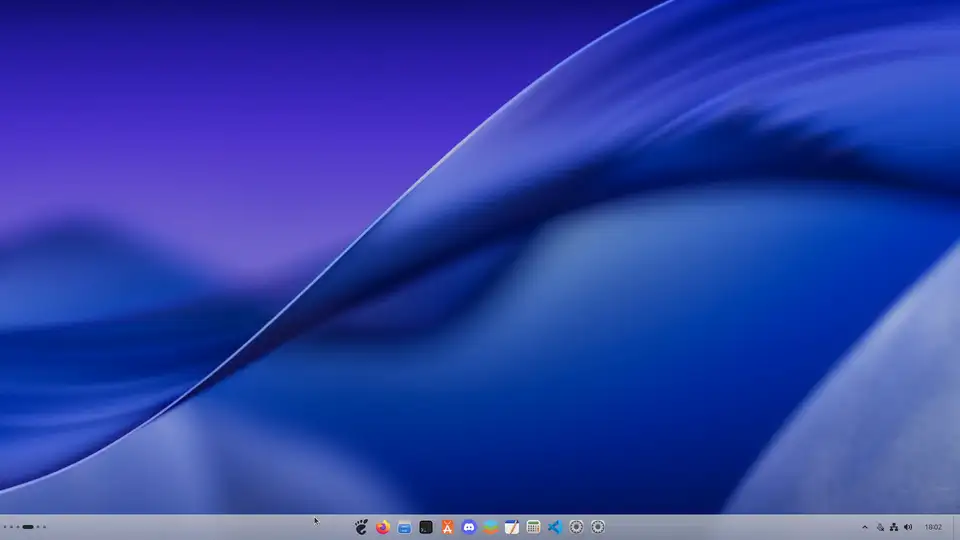
        <b>Start Menu in the Light Theme</b>
    </td>
    <td align="center" width="50%">
      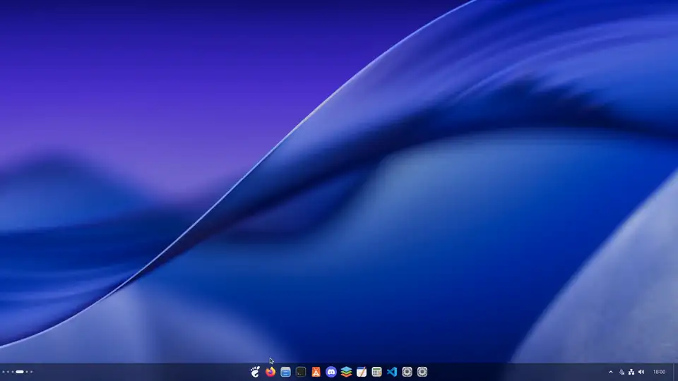
        <b>Start Menu in the Dark Theme</b>
    </td>
  </tr>
</table>

## Choose your layout

| Mode | What you get |
| --- | --- |
| **Taskbar** | Pinned apps and open windows together on the panel, full width or sized to its contents and floating. |
| **Dock** | A separate app Dock alongside the GNOME panel. |
| **Windows XP** | A classic taskbar with Windows XP-inspired artwork and styling. |
| **Windows 10** | A Windows 10-inspired taskbar with rectangular highlights. |
| **Default GNOME Panel** | GNOME's familiar panel, with optional window buttons. |

Choose your mode in **General**. Your settings are remembered when you switch
away and return.

## Install

Install from [GNOME Extensions](https://extensions.gnome.org/extension/10448/simple-taskbar/)
or search for **Simple Taskbar** in Extension Manager, then enable it.

### Install from source

To install the current source version:

    git clone https://github.com/Sultech/simple-taskbar.git
    cd simple-taskbar
    ./package.sh
    gnome-extensions install --force dist/simple-taskbar@sultech.shell-extension.zip
    gnome-extensions enable simple-taskbar@sultech

Log out and back in if GNOME Shell does not discover a newly installed extension.

## What you can do

- **Keep apps close:** pin favourites, drag to reorder, and group windows or give each one its own button.
- **Find the right window:** use previews, hover to peek inside a window, or switch with a live Alt+Tab grid.
- **Make it yours:** choose colours, light or dark themes, icon sizes, running indicators and animations.
- **Make room:** place the taskbar or Dock on any screen edge and hide it automatically when you need space.
- **Use a Start Menu:** search for apps, organise pins into folders and add shortcuts to common locations.
- **Work across monitors:** choose where panels appear and which apps each one shows.
- **Add useful extras:** Show Desktop, app volume controls, notification badges, progress bars and folder shortcuts.

## Make it yours

Open the preferences in Extension Manager, or right-click empty taskbar or Dock
space and choose the settings item. Open a category to see its controls;
cogwheels reveal additional options.

| Page | Where to start |
| --- | --- |
| **General** | Choose a mode, set up the app grid, hot edge, Alt+Tab grid and file manager, and back up your settings. |
| **Taskbar** | Adjust the panel's appearance, apps, items and hiding behaviour. |
| **Dock** | Customise the Dock when Dock mode is selected. |
| **Start Menu** | Choose the button, menu appearance, pinned-app options and shortcuts. |
| **About** | Find project information, links, credits and support. |

<table>
  <tr>
    <td align="center" width="50%">
      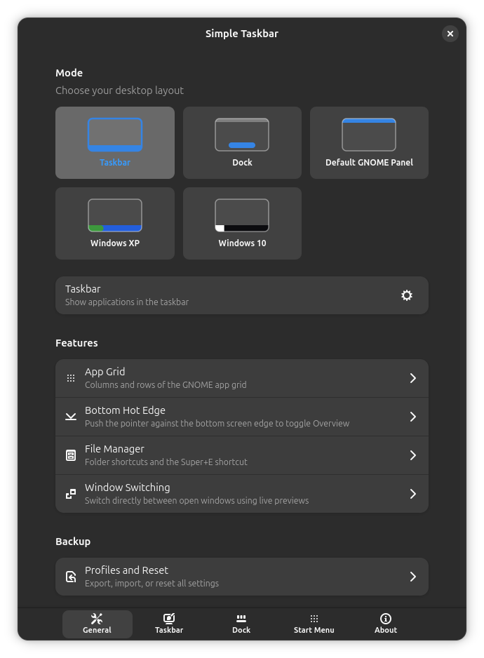
        <b>General</b>
    </td>
    <td align="center" width="50%">
      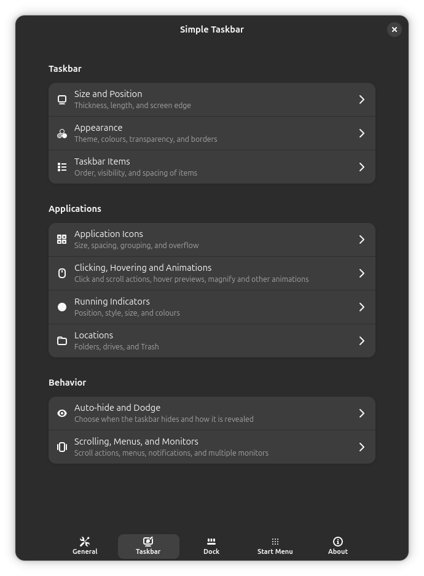
        <b>Taskbar</b>
    </td>
  </tr>
  <tr>
    <td align="center" width="50%">
      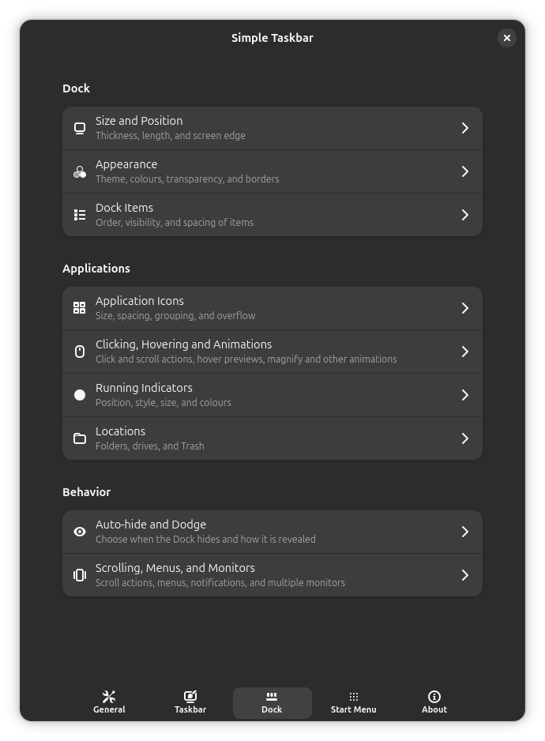
        <b>Dock</b>
    </td>
    <td align="center" width="50%">
      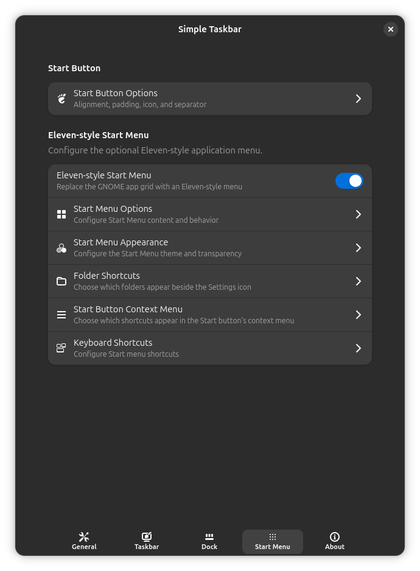
        <b>Start Menu</b>
    </td>
  </tr>
</table>

### Save your settings

Go to **General → Profiles and Reset** to export a backup or import one later.
Resetting settings keeps your pinned apps and Start Menu pins.

More about profiles

Each desktop mode keeps its own settings. Taskbar, Dock and Default GNOME Panel
also support separate horizontal and vertical profiles, which can be disabled
in the mode options. Start Menu pins are shared across modes.

Export and import profiles containing panel settings, Dock settings and Start
Menu pins from **General → Profiles and Reset**. Imported values outside the
current setting limits return to their defaults. Reset All Settings is available
there too and preserves taskbar favourites and Start Menu pins.

### Keyboard Shortcuts

| Shortcut | Action |
| --- | --- |
| **Super** | Opens the Start Menu, moving Overview to **Super+Tab** or a shortcut of your choice |
| **Super+Tab** | Opens the Start Menu instead, when the Super shortcut is off |
| **Super+E** | Opens the home folder in the default file manager |
| **Super+1** … **Super+9** | Activates that pinned application; pressing it again on the focused one minimises it |

Shortcuts can be changed or turned off in the preferences. You can also choose
your own shortcut for the Start Menu.

All features and detailed controls

The mode options on the General page let you choose whether to hide GNOME's
Overview Dash and start the session on the desktop. Startup changes apply at
the next login. Windows XP and Windows 10 apply their own styling, with
conflicting controls disabled while active.

Default GNOME Panel mode can show labelled running windows on horizontal
panels, with their own icon, interaction and indicator settings. In Dock mode,
the GNOME panel and Dock have separate Overview options.

Simple Taskbar follows GNOME's application favourites and their order, so
pinning anywhere updates the taskbar, the Dock and GNOME's own Dash together.

### Applications

- **Click actions** — choose from *Cycle Windows + Minimize*, *Cycle Through Windows*,
  *Toggle Single / Preview Multiple*, *Toggle Single / Cycle Multiple*,
  *Toggle Single / Spread Multiple*, *Toggle Windows*, *Raise Windows* and *Launch New Instance*
- **Modifier clicks** — Shift+click, Ctrl+click, middle-click and Shift+middle-click each take their own action, including *Quit* and *Minimize Window*
- **Hover action** — show window previews, show a tooltip, or do nothing
- **Window previews** with separate show and hide delays up to 2000ms, and optional middle-click to close the window
- **Window peeking** brings the hovered window to the front temporarily, with its own delay and an adjustable opacity for the other windows
- **Spread windows** — one click spreads just that application's windows in Overview, including windows on other workspaces
- **Scroll over an icon** to switch workspace or cycle that application's windows, with an adjustable delay
- **Drag to reorder** pinned applications and move running groups
- **Grouping** — *Always* (one icon per application), *Only When Full* (split until space runs out) or *Never* (one per window)
- **Window titles** beside split icons, with adjustable font size, weight, a 30–1000px maximum width and an optional fixed width, or hidden entirely
- **Notification badges** showing unread counts on application icons
- **Progress bars** for file transfers and installations reported by supported applications,
  with running-indicator or custom colours and automatic or manual thickness; disabled by default
- **Overflow** — a *Taskbar Flyout* or *Application List* popup for what does not fit. Dragging works across visible and overflow entries, and the popup stays open while dragging
- **Scrolling taskbar** when overflow is off, moving through applications instead of switching workspaces
- **Pinned launchers** — keep favourites as launchers and show their windows separately
- **Keep pinned windows together** — place a pinned application's windows beside its pinned button
  when grouping is *Only When Full* or *Never*; unavailable with separate pinned launchers
- **Visibility** — hide pinned applications, hide unpinned ones, or hide pinned applications on secondary monitors only
- **Isolation** by current workspace or by the monitor the taskbar is on
- **Separators** between pinned and running applications, and between applications and locations

### Icons and Effects

- **Icon size** 13–128px, **spacing** 0–16px, and a **minimum size** for when space runs short
- **Icon edge padding** 3–20px to control the space between icons and the panel edges
- **Alignment** — left or centre on horizontal panels, top or middle on vertical panels
- **Hover animation** — *Simple*, *Ripple* or *Magnify*, each with a tunable profile: duration,
  rotation, travel, zoom, curve convexity and how many neighbouring icons react. The Dock grows with
  magnified icons; magnification is unavailable while application labels are visible or for
  running windows in Default GNOME Panel mode
- **23 click animations** — Bounce, Jump, Heartbeat, Squish, Jelly, Spin, 3D Spin,
  Horizontal Flip, Roll, Zoom Out & Fade, Squeeze, Glow, Dim, Tada, Swing, Shake, Nudge
  Up/Down/Left/Right, Pulse Larger, Pulse Smaller and GNOME Launch Zoom
- **Hover and focus effect** — *Glass*, or *Classic* with its own hover and pressed
  colours, highlight border radius, focused-application highlight, opacity, and an
  option to take the colour from the icon itself
- **Highlight dimensions** — adjustable size and length, plus configurable space beside running indicators
- **Window minimize effect** — GNOME's default or **Magic Lamp**
- **Running indicators** — eight styles (Rounded, Dots, Squares, Dashes, Segmented,
  Solid, Ciliora, Metro) on any edge of the icon, 1–5px thick, optionally stretched to
  the icon's full length, with custom focused and unfocused colours or **Match Icon
  Color** taken from the application's own icon

### Panel Appearance

- **Thickness** up to 175px, with a 30px minimum in Default GNOME Panel mode; the minimum in taskbar mode depends on icon edge padding
- **Match thickness to icon size**, or set the thickness manually and let oversized icons shrink to fit
- **Position** on the top, bottom, left or right edge
- **Dynamic Panel Mode** sizes the taskbar to its contents and expands as items are added, up to 1–90% of the monitor
- **Floating Panel Mode** adds a small gap from the screen edge that closes for maximized windows;
  it works on its own or with Dynamic Panel Mode, with a corner radius up to 64px
- **Themes** — light, dark, or follow GNOME Shell
- **Custom colours**, gradients, gradient direction, and light or dark panel text
- **Transparency** and separate borders per light and dark theme
- **Dynamic transparency** for the taskbar and Dock independently, based on all windows,
  the focused application's windows, the focused window or maximized windows, with adjustable
  trigger distance, transparency when no window matches, and animation duration
- **Blur My Shell** translucency and blur on primary and secondary panels, with Simple Taskbar's own background as the fallback on secondary panels

### Behaviour

- **Auto-hide** with animation on every panel, revealed at the screen edge
- **Dodge windows** — hide for all windows, the focused application's windows, only the focused window, or only maximized windows, with an optional pointer reveal
- **Intellihide options** — instant, delayed or pressure-based edge reveal, adjustable hide delay, optional pointer reveal over fullscreen applications,
  reveal while the Overview is open, and an option to limit reveal to a dynamic or floating taskbar's own edge
- **Hot edge** at the bottom that toggles Overview, with adjustable activation pressure and an optional ripple
- **App Grid layout** — automatic sizing or custom dimensions of 2–12 columns and 2–10 rows,
  available under **General → App Grid**
- **Scroll over empty space** to switch workspace, cycle windows or change volume, with an adjustable delay
- **Application volume mixer** in Quick Settings for individual streams, going above 100% when GNOME's over-amplification is on
- **Tray icons** gathered behind a panel arrow, positioned where you want it
- **Task Manager** entry in the panel menu — any installed application, defaulting to
  Resources and falling back to GNOME System Monitor or Mission Center when it is missing
- **Multi-monitor** — show the taskbar on every connected monitor
- **Click-to-open menus** instead of switching panel menus on hover
- **Notification banners** aligned to the panel edge and clock position
- **Lock the taskbar** against accidental rearrangement

### Panel Items

Three item groups — **Left**, **Center** and **Right** on horizontal panels, or
**Top**, **Middle** and **Bottom** on vertical ones — hold the Start and
Activities buttons, Applications, Folder Menu, the tray icon arrow, the System
Menu (Quick Settings, volume, network and power), Clock and Show Desktop.

- **Item ordering** with Move Up and Move Down inside each group, around a fixed box row for other GNOME Shell and extension items
- **Button padding** — Automatic follows Just Perfection when present and 3px otherwise,
  while an explicit 0–20px value takes precedence. Default GNOME Panel mode starts
  at 12px; each mode remembers its own value
- **Quick Settings icon spacing** — use GNOME's default or set 0–20px between status icons
- **Folder Menu** opens files from a chosen directory with their default applications
- **Show Desktop** minimises visible windows and restores them on the next click. By default,
  restoring a window yourself cancels the saved group, so the next click hides visible windows
  again. Turn off **Cancel Show Desktop When a Window Is Restored** in its cogwheel to keep
  restoring the remaining hidden windows
- **Show Desktop appearance** — adjustable button width, an invisible-button option and a custom separator colour
- **Reset All Settings** restores defaults without touching taskbar favourites or Start Menu pins

### Locations

- Common folders, Trash, and connected drives and volumes, in the taskbar and the Dock independently
- Drive entries can be limited to mounted drives, or include network volumes
- Home, Desktop, Documents, Downloads, Music, Pictures and Videos shortcuts in the Nautilus application menu

### Dock

Dock mode moves applications out of the panel into a separate Dock, with its own
copy of the icon, effect, indicator, overflow and isolation settings.

- Placement on any edge, independent of the taskbar's own position
- **Maximum length** from 1–90% of the monitor, or a full-width Dock reaching the edges
- **Corner radius** up to 64px, plus independent themes, transparency, gradients, text
  colour, borders and Blur My Shell
- **Full-width Dock thickness** can follow icon size or be set manually
- **Floating** option for both the Dock and the full-width Dock, keeping a small gap from the screen edge
- **Auto-hide** with the same window-dodge modes, its own reveal and hide timings, reveal in Overview,
  and an option to limit reveal to the Dock's own edge
- **Scroll** over empty Dock space to switch workspace, cycle windows or change volume
- Shown on every connected monitor, with its own item order and locations

### Start Menu

The Eleven-style Start Menu is enabled by default.

- **Pinned grid** with drag-and-drop ordering and optional titles under icons
- **Folders** created by dragging one pinned application onto another, with renaming, a
  *Move out of folder* action, and *Open All* from the folder's menu or with middle-click
- **Global search** through GNOME, including compatible system and extension providers
- **All Apps** view with selectable categories or one alphabetical list, and the option to open there by default
- **Application menus** — open windows, launcher actions, App Details, Quit, Pin to Start, Pin to Taskbar or Dock, and desktop shortcuts when a supported desktop-icons extension is active
- **Drag from All Apps** onto the taskbar or Dock to pin
- **Recommended applications**, which can exclude what is already pinned
- **Running indicators** under applications that are open
- **Folder shortcuts** beside the Settings icon, plus the account profile picture and a footer power menu
- **Keyboard navigation** with Tab and the arrow keys, and delayed tooltips carrying names and descriptions
- **Type to search** while a menu item is focused, without first selecting the search field
- **Themes** — dark, light or follow GNOME Shell, with panel-matched transparency and optional monitor-centred positioning

The Start button can be the Eleven-style button or GNOME's original
Applications button. It follows application alignment or takes a manual
position, with custom padding, an optional separator and a bundled or personal
icon. In Default GNOME Panel mode it can sit in the Dock or in the panel, with
its own position. Padding stays inside the clickable button so it can reach the screen edge;
either button can be hidden, and right-clicking the Eleven-style button
opens its settings. Its context menu can offer Installed Apps, Event Viewer,
System, Network Connections, Disk Management, Terminal, Task Manager, File
Explorer, Run and Desktop.

### Window Switching

Grid Alt-Tab replaces the application switcher with a responsive grid of live
window previews, keeping normal Alt+Tab and Shift+Alt+Tab selection. It is
enabled by default, supports pointer and arrow-key navigation, and activates
the selected window when Alt is released.

- Maximum preview card size, 120–500px
- All workspaces or only the current one
- All monitors or only the monitor showing the switcher
- Popup on the current monitor or always the primary

## Using other extensions

Simple Taskbar supports Blur My Shell styling and blur. Compatible desktop-icon
extensions also let you add desktop shortcuts from the Start Menu.

Dash to Panel is disabled while Simple Taskbar is active. Dash to Dock and
Ubuntu Dock remain available in Default GNOME Panel mode, but are disabled in
the other modes.

## Privacy

Simple Taskbar does not collect telemetry or access the network. GNOME's search
providers handle their own results; some can copy result text to the clipboard
when you activate a result.

## Remove

Disable Simple Taskbar and uninstall it through Extension Manager or the
GNOME Extensions app.

Development, packaging and troubleshooting

Open the preferences from a terminal with:

    gnome-extensions prefs simple-taskbar@sultech

### Development

GNOME Shell caches imported extension modules for the lifetime of the Shell
process. Disable and re-enable is not enough to load edited JavaScript into the
same process.

On Ubuntu, install:

    sudo apt install mutter-dev-bin gettext

Then run:

    ./dev.sh

The helper compiles the schema, creates a development symlink under
<code>~/.local/share/gnome-shell/extensions/</code> and starts a fresh nested
GNOME Shell development session in a window. Close that window and run
<code>./dev.sh</code> again after changing JavaScript. The real desktop session
remains running.

If a copied installation already occupies the destination, disable the
extension and move or remove that directory before running the helper. Do not
keep backup extension directories under
<code>~/.local/share/gnome-shell/extensions</code>, because GNOME Shell still
scans them.

For runtime problems, use Looking Glass or the journal:

    journalctl -f -o cat /usr/bin/gnome-shell

### Build a package

Building requires <code>msgfmt</code> from GNU gettext,
<code>glib-compile-schemas</code> and <code>gnome-extensions</code>:

    ./package.sh

The package is written to:

    dist/simple-taskbar@sultech.shell-extension.zip

An alternative output directory can be supplied:

    ./package.sh /tmp/simple-taskbar-package

The archive contains the runtime modules, preferences, schema, licence,
bundled artwork, attribution notices and compiled translations. Development
scripts, translation sources and generated schema binaries are left out.

### Manual removal

    gnome-extensions disable simple-taskbar@sultech
    rm -rf ~/.local/share/gnome-shell/extensions/simple-taskbar@sultech

## Licence

Simple Taskbar is distributed under
[GPL-2.0-or-later](COPYING). Bundled third-party icon credits and trademark
notices are listed in [ASSET-CREDITS.md](ASSET-CREDITS.md).
